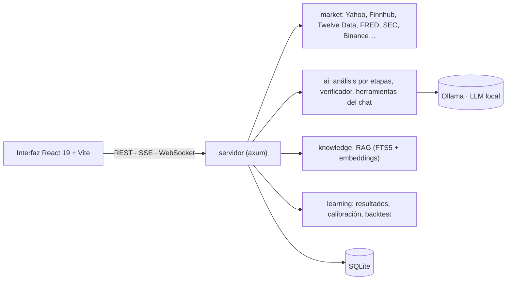

# invest-ai

**Una app local de análisis de inversión con IA en la que cada cifra se puede rastrear hasta su fuente.**
Analiza si un activo (acciones, ETF, cripto, bonos, índices, divisas, materias primas) parece buena inversión con datos de
mercado en vivo, fundamentales y noticias, y un **LLM local** (Ollama) que explica un veredicto construido con cifras que
calcula el código, nunca con cifras que se inventa el modelo.

[English](README.md) · [Arquitectura](docs/ARCHITECTURE.md) · [API](docs/API.md) · [Sistema de diseño](DESIGN.md)

[](https://github.com/Chuwi12/invest-ai/actions/workflows/ci.yml)


> **No es asesoramiento financiero.** Todo lo que genera la app es análisis automatizado y puede contener errores.

## Demostración

[](docs/media/demo.mp4)

**[▶ Ver el vídeo de demostración (MP4)](docs/media/demo.mp4)**: la app real, datos de mercado reales y un análisis
generado por el modelo local (las esperas del modelo van aceleradas y lo indica el vídeo). No hay
una demo pública alojada: la app está pensada para ejecutarse en tu propio equipo (ver [Requisitos](#requisitos)).

| Landing (claro) | Landing (oscuro) |
|---|---|
|  |  |

| Análisis de un activo | Panel |
|---|---|
|  |  |

## Qué la hace distinta

- **El código calcula, el modelo explica.** Las cifras derivadas (ratios de valoración, niveles técnicos, puntuaciones,
  entrada, stop y objetivos) se calculan en Rust y se le pasan al modelo. Un **verificador** descarta o marca (⚠)
  cualquier cifra de la respuesta que no aparezca en los datos, y cada afirmación cita su fuente (referencias `[D#]` a
  documentos reales).
- **Privada por construcción.** El LLM corre en local (Ollama, con un modelo elegido según tu hardware), el servidor solo
  escucha en loopback y no hay cuentas ni nube.
- **Honesta con sus límites.** Mide sus propios veredictos frente al mercado con una regla fija y publica el resultado
  aunque no la favorezca: el backtest de los factores de precio de la puntuación **no mostró ventaja frente al mercado**
  (más de 100 valores de EE. UU. desde 2018; ninguna de las 12 pruebas fijadas de antemano superó el umbral). Ver
  [docs/notes/backtest.md](docs/notes/backtest.md).

## Funciones

- Ficha de activo con cotización en vivo (ticks por WebSocket), gráficos, fundamentales, noticias y un análisis de IA por
  etapas (rápido o estándar).
- Chat con herramientas sobre datos en vivo: muestra qué herramientas usó y de dónde sale cada cifra.
- **Lista de seguimiento** con una pasada por día de bolsa de EE. UU. (ventana entre el cierre y la apertura siguiente,
  con horario de verano).
- **Historial de aciertos**: qué hizo el precio tras cada veredicto a 1, 4 y 12 semanas frente a un índice de
  referencia, con calibración de la confianza.
- Módulo de **OPV** con tasa base por tamaño de la oferta, y **RAG** sobre noticias y folletos (búsqueda híbrida SQLite
  FTS5 + embeddings).
- Gestor de modelos que recomienda e instala modelos de Ollama según tu RAM y VRAM.
- Tema claro y oscuro; se instala como **servicio de usuario de systemd** endurecido, a partir de una copia inmutable.

## Arquitectura



| Capa | Tecnología |
|---|---|
| Backend | Rust (edición 2024), axum, sqlx/SQLite, reqwest (rustls), tokio. Workspace de 6 crates: `domain`, `market`, `ai`, `knowledge`, `learning`, `server` |
| Frontend | React 19, TypeScript, Vite, TanStack Query, lightweight-charts |
| IA | Ollama (por defecto `qwen2.5:7b`), embeddings locales para el RAG |
| Operación | Instalador en Bash, unidades de usuario de systemd, CI con GitHub Actions |

Tests: **931 de backend y 286 de frontend**, más un test del instalador con `systemctl` simulado. Los que necesitan red o
GPU están marcados con `#[ignore]`. Notas de seguridad y auditorías: [docs/notes/security.md](docs/notes/security.md).

## Requisitos

| Requisito | Mínimo |
|---|---|
| Sistema | Linux (systemd opcional, para el servicio en segundo plano) |
| Rust | estable ≥ 1.85 (edición 2024) |
| Node.js | ≥ 22 (Vite 8) |
| Ollama | versión reciente y un modelo de chat (`qwen2.5:7b` ≈ 4,7 GB) |
| GPU | opcional; NVIDIA con ≥ 8 GB de VRAM recomendada (solo CPU funciona, con minutos por análisis) |
| RAM | 16 GB (32 GB recomendados) |
| Disco | ~10 GB (modelos y compilación) |
| Claves de API | **ninguna obligatoria** (Yahoo, Binance y otras fuentes funcionan sin clave). Opcionales: Finnhub, Twelve Data, FRED, Alpha Vantage, FMP, NewsAPI, Marketaux, CryptoPanic, Reddit, X |

macOS y Windows no están probados.

## Puesta en marcha

```bash
# Instala Rust, Node.js y Ollama con el gestor de paquetes de tu sistema; por ejemplo, en Arch: sudo pacman -S rust nodejs npm ollama
git clone https://github.com/Chuwi12/invest-ai && cd invest-ai
./invest-ai pull          # descarga el modelo por defecto (LLM_MODEL) si falta
./invest-ai               # compila lo que cambió, arranca en 127.0.0.1:8787 y abre el navegador
```

Las claves opcionales van en `.env` (se crea desde [`.env.example`](.env.example) con permisos 600; nunca se imprime ni se
sube al repositorio).

**Probarla sin Ollama ni red** (datos simulados, indicados en pantalla): `./invest-ai --fake`, o solo el frontend con
`cd frontend && npm install && npm run dev:mock`.

| Comando | Qué hace |
|---|---|
| `./invest-ai` | Compila si hace falta, arranca y abre el navegador |
| `./invest-ai dev` | Backend en debug + Vite con HMR en `:5180` |
| `./invest-ai install [--autostart]` | Servicio de **usuario** de systemd endurecido y entrada en el menú de KDE, desde una copia inmutable |
| `./invest-ai status` / `logs` / `stop` | Estado, logs y parada |
| `./invest-ai selftest [--llm]` | Prueba de humo: salud, cotizaciones reales, un tick por WebSocket, modelos y cabeceras de seguridad |

Notas de operación: [docs/notes/ops.md](docs/notes/ops.md).

## Cómo se hizo

Diseñada y dirigida por **Sergio Rodríguez**: arquitectura, decisiones de producto, revisiones y cada integración. La mayor
parte del código la escribieron **agentes de programación con IA** (Claude), trabajando en paralelo en áreas separadas bajo
esa dirección; cada cambio se verificó con tests, linters y revisiones independientes de código, seguridad y diseño antes
del commit (de ahí las líneas `Co-Authored-By`). Las [notas de `docs/notes/`](docs/notes) son la bitácora de esas
decisiones y auditorías.

## Licencia

[GNU AGPL-3.0 o posterior](LICENSE) © 2026 Sergio Rodríguez. Puedes usarla, estudiarla, modificarla y compartirla; si
distribuyes una versión modificada o la ofreces como servicio en red, tienes que publicar tu código con la misma licencia
y conservar los avisos de autoría.
