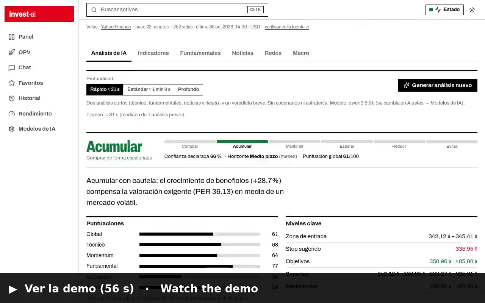
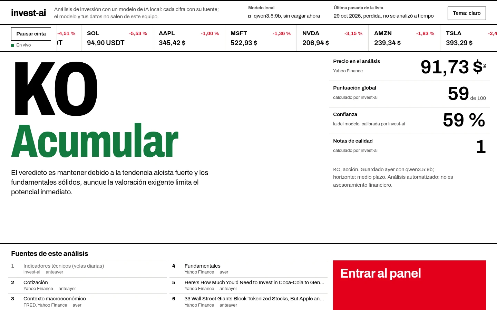
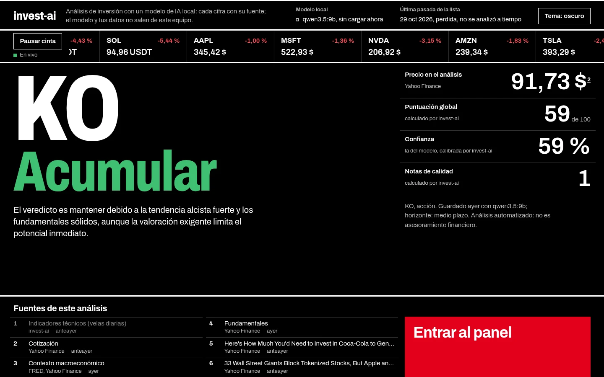
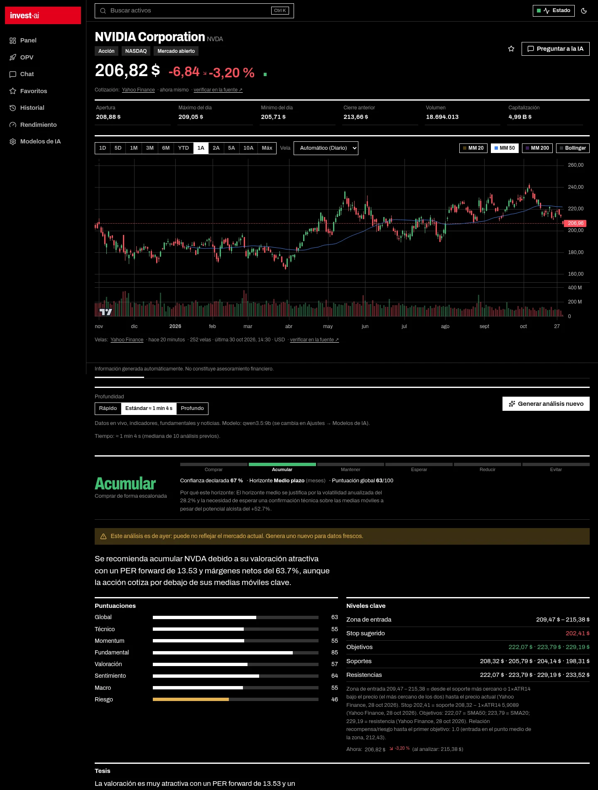
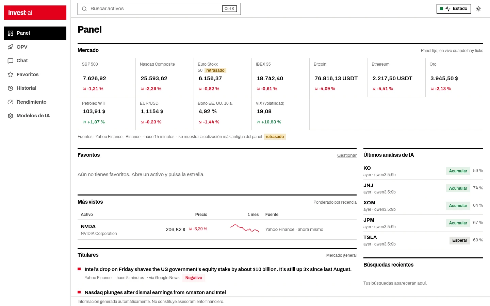
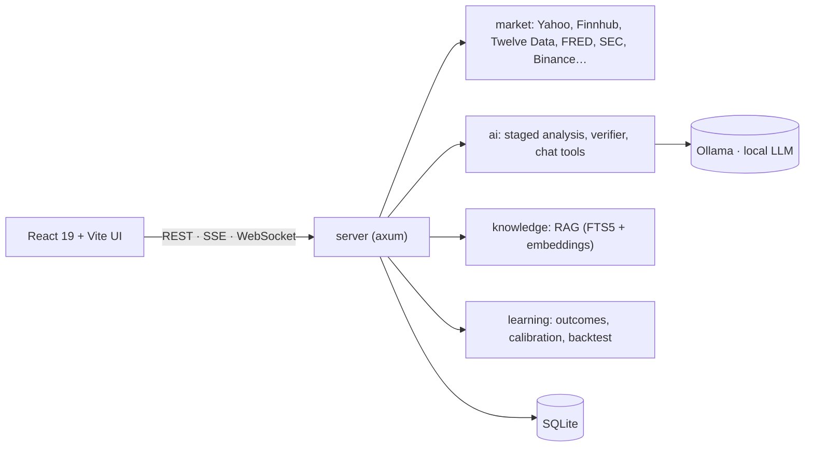

# invest-ai

**A local, AI-native investment research app where every number can be traced to its source.**
It analyses whether an asset (stocks, ETFs, crypto, bonds, indices, FX, commodities) looks like a good investment using
live market data, fundamentals and news, and a **local LLM** (Ollama) that explains a verdict built from figures the
code computes, never figures the model makes up.

[Español](README.es.md) · [Architecture](docs/ARCHITECTURE.md) · [API](docs/API.md) · [Design system](DESIGN.md)

[](https://github.com/Chuwi12/invest-ai/actions/workflows/ci.yml)


> **Not financial advice.** Everything the app produces is automated analysis and may contain errors.

## Demo

[](docs/media/demo.mp4)

**[▶ Watch the demo video (MP4)](docs/media/demo.mp4)**: real app, real market data and a real analysis generated
by the local model on an RTX 4070 Laptop (model waits are sped up and labelled as such). There is no public hosted
demo: the app is designed to run on your own machine (see [Requirements](#requirements)).

| Landing (light) | Landing (dark) |
|---|---|
|  |  |

| Asset analysis | Panel |
|---|---|
|  |  |

## What makes it different

- **The code computes, the model explains.** Derived figures (valuation ratios, technical levels, scores, entry/stop/
  targets) are computed in Rust and handed to the model. A **verifier** drops or flags (⚠) any figure in the model's
  output that cannot be found in the data, and every claim cites its source (`[D#]` references to real documents).
- **Private by construction.** The LLM runs locally (Ollama, model chosen for your hardware), the server only listens
  on loopback, there are no accounts and no cloud.
- **Honest about its limits.** It measures its own verdicts against the market with a fixed rule and publishes the
  result even when it is unflattering: the backtest of the score's price factors **showed no edge over the market**
  (100+ US symbols since 2018; none of the 12 pre-registered tests passed the threshold). See [docs/notes/backtest.md](docs/notes/backtest.md).

## Features

- Asset page with live quotes (WebSocket ticks), charts, fundamentals, news and a staged AI analysis (quick or standard).
- Chat with tool calling over live data; it shows which tools it used and where each figure came from.
- Daily **watchlist** pass scheduled per US trading day (DST-aware window between the close and the next open).
- **Track record**: what the price did after each verdict at 1/4/12 weeks against a benchmark, with confidence calibration.
- **IPO** module with a base rate by offering size, and **RAG** over news and prospectuses (hybrid SQLite FTS5 + embeddings).
- Model manager that recommends and installs Ollama models according to your RAM/VRAM.
- Light and dark themes; installs as a hardened **systemd user service** with an immutable release copy.

## Architecture



| Layer | Stack |
|---|---|
| Backend | Rust (edition 2024), axum, sqlx/SQLite, reqwest (rustls), tokio. Workspace of 6 crates: `domain`, `market`, `ai`, `knowledge`, `learning`, `server` |
| Frontend | React 19, TypeScript, Vite, TanStack Query, lightweight-charts |
| AI | Ollama (default `qwen2.5:7b`), local embeddings for RAG |
| Ops | Bash installer, systemd user units, GitHub Actions CI |

Tests: **931 backend + 286 frontend**, plus an installer test with a simulated `systemctl`. Network/GPU-dependent tests
are marked `#[ignore]`. Security notes and audits: [docs/notes/security.md](docs/notes/security.md).

## Requirements

| | Minimum | Tested on |
|---|---|---|
| OS | Linux (systemd optional, for the background service) | CachyOS (Arch), KDE |
| Rust | stable ≥ 1.85 (edition 2024) | 1.98 |
| Node.js | ≥ 22 (Vite 8) | 24 and 26 |
| Ollama | recent version + one chat model (`qwen2.5:7b` ≈ 4.7 GB) | 0.40 |
| GPU | optional; NVIDIA with ≥ 8 GB VRAM recommended (CPU-only works, minutes per analysis) | RTX 4070 Laptop, 8 GB |
| RAM | 16 GB (32 GB recommended) | 32 GB |
| Disk | ~10 GB (models + build) | |
| API keys | **none required** (Yahoo, Binance and others work without a key). Optional: Finnhub, Twelve Data, FRED, Alpha Vantage, FMP, NewsAPI, Marketaux, CryptoPanic, Reddit, X | |

macOS and Windows are not tested.

## Quick start

```bash
# Arch / CachyOS (no automatic sudo): sudo pacman -S rust nodejs npm ollama   (ollama-cuda with an NVIDIA GPU)
git clone https://github.com/Chuwi12/invest-ai && cd invest-ai
./invest-ai pull          # downloads the default model (LLM_MODEL) if it is missing
./invest-ai               # builds what changed, starts on 127.0.0.1:8787 and opens the browser
```

Optional keys go in `.env` (created from [`.env.example`](.env.example) with mode 600; it is never printed or committed).

**Try it without Ollama or network** (simulated data, clearly labelled): `./invest-ai --fake`, or only the frontend with
`cd frontend && npm install && npm run dev:mock`.

| Command | What it does |
|---|---|
| `./invest-ai` | Build if needed, run, open the browser |
| `./invest-ai dev` | Debug backend + Vite with HMR on `:5180` |
| `./invest-ai install [--autostart]` | Hardened systemd **user** service + KDE menu entry, from an immutable release copy |
| `./invest-ai status` / `logs` / `stop` | Status, logs, stop |
| `./invest-ai selftest [--llm]` | Smoke test: health, real quotes, a WebSocket tick, models and security headers |

## How it was built

Designed and directed by **Sergio Rodríguez**: architecture, product decisions, reviews and every merge. Most of the code
was written by **AI coding agents** (Claude) working in parallel on separate areas under that direction, with each change
verified by tests, linters and independent code, security and design reviews before it was committed (hence the
`Co-Authored-By` lines). The [notes in `docs/notes/`](docs/notes) are the working log of those decisions and audits.

## License

[GNU AGPL-3.0-or-later](LICENSE) © 2026 Sergio Rodríguez. You can use, study, modify and share it; if you distribute a
modified version or offer it as a network service, you must release your source under the same license and keep the
copyright notices.
